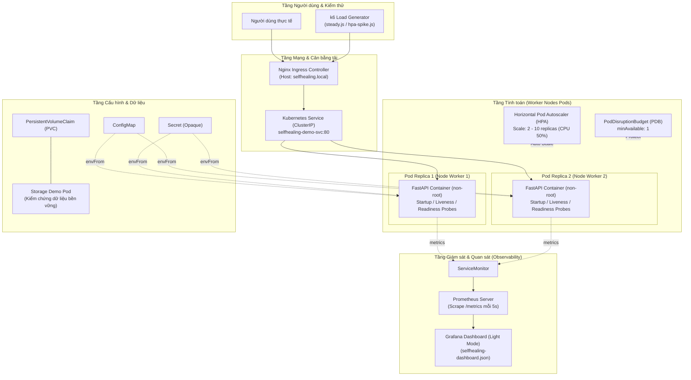
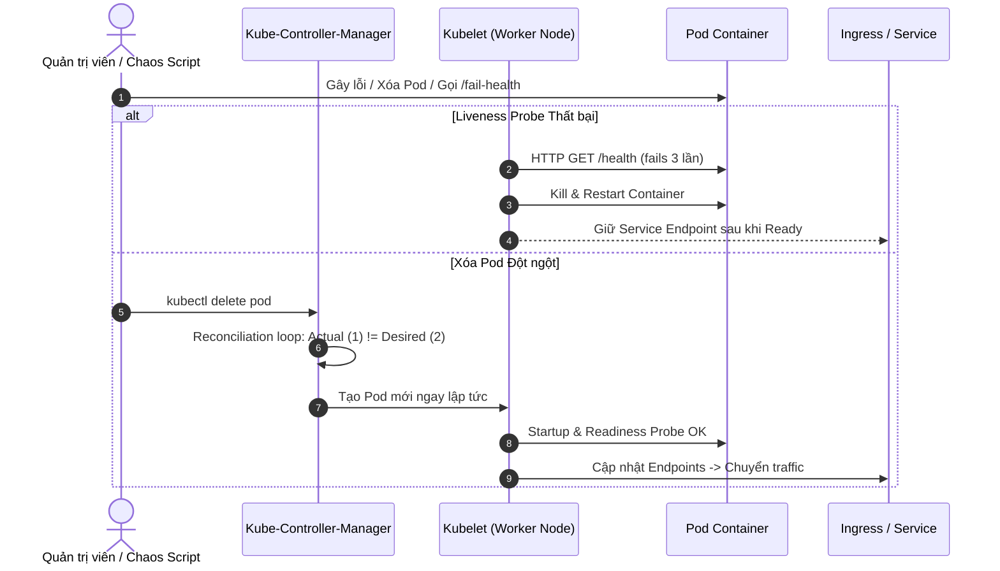

# Cloud-Computing-Project

**Đề tài 26:** Triển khai ứng dụng trên Kubernetes với tự phục hồi, co giãn và cập nhật không gián đoạn.

Demo minh họa self-healing (liveness/readiness/startup probe), autoscaling (HPA), rolling update + rollback,
PodDisruptionBudget và lưu trữ bền vững (PVC), giám sát bằng Prometheus/Grafana trên cụm Kubernetes cục bộ.

**Câu hỏi nghiên cứu:** Các controller và health probe của Kubernetes phối hợp như thế nào để duy trì trạng thái
mong muốn khi pod lỗi, tải tăng hoặc phiên bản mới gặp sự cố?

## Kiến trúc Hệ thống

### 1. Sơ đồ Kiến trúc Đa tầng (Multi-layer Architecture)



### 2. Sơ đồ Luồng Tự phục hồi & Điều phối (Reconciliation Loop)



## Cấu trúc project

```text
Cloud-Computing-Project/
├── app/                        # Ứng dụng mẫu
│   ├── main.py                 # /, /ui, /api/info, /health, /ready, /load, /version, /metrics, /fail-health
│   ├── requirements.txt
│   └── Dockerfile              # multi-stage build, chạy non-root
├── k8s/
│   ├── kind-config.yaml        # 1 control-plane + 2 worker nodes
│   ├── secret.example.yaml     # chỉ giá trị giả (CHANGE_ME), nằm ngoài base/
│   ├── base/                   # deployment, service, configmap, ingress, hpa, pdb, pvc, storage-demo
│   └── experiments/            # cấu hình cố ý sai: liveness quá gắt, memory limit quá thấp, thiếu readiness
├── monitoring/
│   ├── prometheus-values.yaml  # values cho kube-prometheus-stack
│   ├── servicemonitor.yaml     # scrape /metrics của app (5s)
│   └── selfhealing-dashboard.json
├── load-test/
│   ├── steady.js               # tải nền ổn định 20 VUs (baseline, xóa pod, drain, rollout)
│   └── hpa-spike.js            # tải tăng đột biến CPU để kích hoạt HPA
├── scripts/
│   ├── setup.ps1               # dựng toàn bộ cụm + deploy (chạy 1 lần)
│   ├── demo.ps1 / demo.sh      # menu 1 phím điều khiển kịch bản trực quan trên TV lớp học
│   ├── teardown.ps1            # xóa cụm kind
│   ├── chaos-pod-delete.sh     # xóa pod / drain node
│   ├── rollout-fail.sh         # phát hành bản lỗi + rollback
│   ├── collect-metrics.py      # xuất số liệu thô JSON + CSV từ Prometheus
│   └── plot-results.py         # vẽ biểu đồ từ data/results/
├── Makefile                    # phím tắt lệnh demo cho Linux/macOS/WSL
├── data/results/               # số liệu đo thô dạng JSON và CSV
├── docs/
│   ├── test-plan.md            # bảng kiểm thử + tiêu chí đạt
│   ├── finops-cost-analysis.md # báo cáo FinOps & tối ưu chi phí Cloud
│   ├── reports/                # báo cáo đồ án
│   └── results/                # biểu đồ kết quả
└── README.md
```

## Run guide

**Yêu cầu:** Docker Desktop, `kubectl`, `kind`, `helm`, `k6`, Python 3.10+.

**Cách 1 — Script tự động (khuyên dùng, Windows PowerShell):**

```powershell
git clone https://github.com/dzytan/Cloud-Computing-Project.git
cd Cloud-Computing-Project
.\scripts\setup.ps1          # dựng cụm + cài hạ tầng + deploy ứng dụng
.\scripts\demo.ps1           # mở Menu 1 phím + Live Pod UI (http://localhost/ui) + Grafana (:3000)
```

Dọn dẹp khi xong: `.\scripts\teardown.ps1`

**Cách 2 — Linux / macOS / WSL:**

Xem các bước lệnh tương đương trong [`scripts/setup.ps1`](scripts/setup.ps1), sau đó chạy `make demo` (hoặc `bash scripts/demo.sh`).

## Kịch bản thử nghiệm

Mỗi kịch bản chạy **cùng lúc với tải nền k6** (`steady.js`), lặp **3 lần** và lấy trung bình.

| # | Kịch bản | Cách thực hiện | Quan sát |
|:--|:---|:---|:---|
| 1 | Baseline | Không can thiệp | availability, p95 làm mốc |
| 2 | Xóa pod | `bash scripts/chaos-pod-delete.sh pod` | thời gian về đủ replica, số lỗi |
| 3 | Lỗi health endpoint | gọi `/fail-health` | restart count, thời gian phục hồi |
| 4 | Drain node | `bash scripts/chaos-pod-delete.sh drain` | PDB có giữ pod Ready, downtime |
| 5 | Rollout bản tốt | `kubectl set image ... selfhealing-demo:v2` | thời gian rollout, lỗi khi cập nhật |
| 6 | Rollout bản lỗi + rollback | `bash scripts/rollout-fail.sh` | bản lỗi không nhận traffic, thời gian rollback |
| 7 | Autoscaling | `k6 run load-test/hpa-spike.js` | thời gian scale up, scale down |

**Thử nghiệm bổ sung**

- **Cấu hình sai** (`k8s/experiments/`): apply từng file, ghi triệu chứng, lệnh chẩn đoán và ảnh hưởng đến dashboard.
- **Storage:** xóa pod `storage-demo` rồi kiểm tra file ghi trên PVC còn nguyên.

Rolling update dùng `maxSurge: 1`, `maxUnavailable: 0` nên pod mới phải Ready thì pod cũ mới bị gỡ.
Deployment dùng `topologySpreadConstraints` để các replica không rơi cùng một node.

## Tiêu chí đạt

Ngưỡng dưới đây là đề xuất, nhóm chốt lại trong [`docs/test-plan.md`](docs/test-plan.md) **trước khi đo**, sau khi có số liệu baseline.

| Kịch bản | Tiêu chí đạt (đề xuất) |
|:---|:---|
| Xóa pod | availability ≥ 99%, về đủ replica < 30 s |
| Lỗi health endpoint | container tự restart, restart count tăng |
| Drain node | luôn còn ≥ 1 pod Ready, availability ≥ 99% |
| Rollout bản tốt | số lỗi ≈ 0 |
| Rollout bản lỗi | không request nào tới bản lỗi, rollback < 60 s |
| HPA | scale up < 3 phút, scale down sau cửa sổ stabilization |
| PVC | dữ liệu giữ nguyên sau khi xóa pod |

## Công nghệ

| Thành phần | Công nghệ | Phiên bản (ghi khi nghiệm thu) |
|:---|:---|:---|
| Cụm K8s | kind + Kubernetes | `kind v0.24+`, `Kubernetes v1.31+` |
| Ứng dụng | Python + FastAPI + Uvicorn | `python:3.11-slim`, `fastapi 0.115.6` |
| Ingress | Nginx Ingress Controller | `controller-v1.12.1` |
| Autoscaling | HPA (`autoscaling/v2`) + Metrics Server | `v0.7.2` |
| Giám sát | kube-prometheus-stack (Helm) | `prometheus-community/kube-prometheus-stack` |
| Quản trị trực quan | Headlamp / K9s | `headlamp/headlamp` (Web UI Light Mode) |
| Tạo tải | Grafana k6 | `k6 v0.54+` |

## Bảo mật

- `secret.example.yaml` chỉ chứa giá trị giả, không commit secret thật. Secret thật tạo bằng `kubectl create secret` trước khi apply.
- Container chạy non-root (`USER 10001` trong Dockerfile, `securityContext.runAsNonRoot: true`, `allowPrivilegeEscalation: false`).
- Giới hạn còn lại: Ingress/Grafana chạy HTTP, mật khẩu Grafana đặt mặc định `admin/admin` trong `prometheus-values.yaml` phục vụ lab cục bộ (cần đổi sang Secret khi lên production); image chưa quét lỗ hổng CVE; Secret mặc định của K8s mới chỉ mã hóa base64 (chưa bật KMS encryption at rest).

## Chi phí

Toàn bộ demo chạy trên cụm kind cục bộ, không phát sinh chi phí cloud.
Ước tính chi phí triển khai trên AWS EKS và phân tích rightsizing tài nguyên xem tại [`docs/finops-cost-analysis.md`](docs/finops-cost-analysis.md).

## Demo trực quan trên TV tại lớp

- **Menu điều khiển 1 phím bấm:** `.\scripts\demo.ps1` (Windows) hoặc `make demo` / `bash scripts/demo.sh` (Linux/WSL).
- **Live Pod Traffic Frontend (Light Mode):** `http://localhost/ui` — tự động gọi qua Ingress mỗi 1s, hiển thị trực quan Pod Name, Pod IP, Worker Node, Health và màu sắc phiên bản (`v1` Xanh dương, `v2` Cam).
- **Headlamp K8s Web UI:** `http://localhost:4466` (bấm phím `[H]` trong menu để tự cài & copy sẵn Token vào Clipboard).
- **Grafana Dashboard (Light Mode, refresh 5s):** `http://localhost:3000` (`admin` / `admin`) — import file `monitoring/selfhealing-dashboard.json`.
- Biểu đồ kết quả sau khi chạy thực nghiệm (phím `[7]`) sẽ được xuất vào `data/results/` (JSON + CSV) và `docs/results/` (PNG).

## Phân công Nhóm

| Thành viên | Vai trò chính | Trách nhiệm trọng tâm |
|:---|:---|:---|
| **Trần Duy Tân** | SV1 - Kiến trúc, hạ tầng, IaC & triển khai | Cụm K8s đa node, manifest `base/`, probe, resource limit, PDB, PVC, `experiments/`, kịch bản drain |
| **Trần Hồng Sơn** | SV2 - Ứng dụng, dữ liệu, tích hợp & tự động hóa | FastAPI app + `/metrics`, Dockerfile multi-stage (3 image), HPA, `chaos-pod-delete.sh`, `rollout-fail.sh` |
| **Nguyễn Ngọc Sum** | SV3 - Kiểm thử, quan sát, đo lường & báo cáo | Grafana dashboard, k6 load test, `collect-metrics.py`, `plot-results.py`, `test-plan.md`, FinOps, video demo |

---

<p align="center">Đồ án Điện Toán Đám Mây - Đề tài 26: Kubernetes tự phục hồi và cập nhật không gián đoạn</p>
