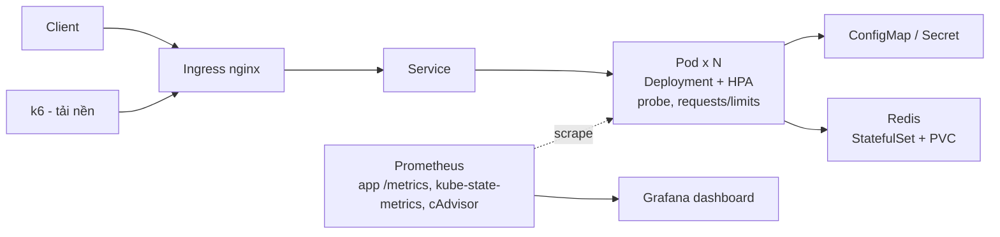

# Cloud-Computing-Project

**Đề tài 26:** Triển khai ứng dụng trên Kubernetes với tự phục hồi, co giãn và cập nhật không gián đoạn
(Deploying a self-healing, auto-scaling, zero-downtime application on Kubernetes).

Demo **K8s-SelfHealing-Demo** minh họa: self-healing (liveness/readiness/startup probe,
reconciliation loop), autoscaling (HPA), rolling update + rollback, PodDisruptionBudget, lưu trữ bền vững (PVC)
và giám sát bằng Prometheus/Grafana trên một cụm Kubernetes cục bộ.

**Câu hỏi nghiên cứu:** Các controller và health probe của Kubernetes phối hợp như thế nào để duy trì
trạng thái mong muốn khi pod lỗi, tải tăng hoặc phiên bản mới gặp sự cố?

## Mục lục

1. [Kiến trúc tổng quan](#kiến-trúc-tổng-quan)
2. [Cấu trúc project](#cấu-trúc-project)
3. [Run guide](#run-guide)
4. [Các kịch bản thử nghiệm](#các-kịch-bản-thử-nghiệm)
5. [Bảng kiểm thử và tiêu chí đạt](#bảng-kiểm-thử-và-tiêu-chí-đạt)
6. [Chi phí](#chi-phí)
7. [Công nghệ sử dụng](#công-nghệ-sử-dụng)
8. [Bảo mật](#bảo-mật)
9. [Tài liệu](#tài-liệu)
10. [Phân công nhóm](#phân-công-nhóm)

## Kiến trúc tổng quan



Redis lưu bộ đếm và dữ liệu vẫn còn khi pod bị xóa. k6 tạo tải nền để đo availability, p95 latency và số lỗi
trong lúc gây lỗi hoặc rollout.

Sơ đồ chi tiết: [`docs/architecture/cluster-architecture.png`](docs/architecture/cluster-architecture.png).

**Quyết định thiết kế chính**

| Quyết định | Lý do |
|:---|:---|
| 2–3 replica + `topologySpreadConstraints` / `podAntiAffinity` | Nếu các replica rơi cùng một node thì drain node gây downtime thật |
| `maxSurge: 1`, `maxUnavailable: 0` | Rolling update luôn giữ đủ pod Ready, bản lỗi không nhận traffic |
| PDB `minAvailable: 1` | Drain node không được hạ số pod Ready xuống dưới ngưỡng |
| Redis (StatefulSet + PVC) cho trạng thái | PVC loại RWO của kind gắn với một node, nên không mount chung cho nhiều replica app được. Tách phần có trạng thái ra StatefulSet để chứng minh dữ liệu sống sót khi pod bị xóa |
| `imagePullPolicy: IfNotPresent` | Image nạp bằng `kind load` không có trên registry, nếu pull sẽ gặp `ImagePullBackOff` |

## Cấu trúc project

```text
Cloud-Computing-Project/
│
├── app/                              # Ứng dụng mẫu (API demo)
│   ├── main.py                       # Endpoint: /, /health, /ready, /load, /version, /visit, /metrics,
│   │                                 #           /fail-health, /fail-ready (bật cờ lỗi để thử từng loại probe)
│   ├── requirements.txt              # gồm prometheus_client
│   └── Dockerfile                    # chạy bằng non-root user
│
├── k8s/
│   ├── kind-config.yaml              # 1 control-plane + 2 worker, ingress-ready label, extraPortMappings 80/443
│   ├── secret.example.yaml           # CHỈ giá trị giả (CHANGE_ME), nằm NGOÀI base/ để không bị apply nhầm
│   ├── base/                         # Manifest chính, apply bằng `kubectl apply -f k8s/base/`
│   │   ├── deployment.yaml           # replica, 3 loại probe, requests/limits, securityContext, spread constraints
│   │   ├── service.yaml
│   │   ├── configmap.yaml
│   │   ├── ingress.yaml
│   │   ├── hpa.yaml                  # HorizontalPodAutoscaler
│   │   ├── pdb.yaml                  # PodDisruptionBudget
│   │   ├── redis-statefulset.yaml    # Redis + volumeClaimTemplates (PVC)
│   │   └── redis-service.yaml
│   ├── experiments/                  # Biến thể CỐ Ý cấu hình sai, dùng cho phần phân tích độ tin cậy
│   │   ├── liveness-too-aggressive.yaml   # timeout/period quá nhỏ -> restart liên tục
│   │   ├── memory-limit-too-low.yaml      # OOMKilled
│   │   ├── no-requests.yaml               # HPA không tính được %CPU
│   │   ├── requests-too-large.yaml        # pod Pending (không đủ tài nguyên)
│   │   └── no-readiness-probe.yaml        # traffic vào pod chưa sẵn sàng
│   └── helm-chart/                   # (tùy chọn nếu đóng gói bằng Helm)
│
├── monitoring/
│   ├── prometheus/
│   │   ├── prometheus-values.yaml    # values cho kube-prometheus-stack (đã gồm kube-state-metrics + cAdvisor)
│   │   └── servicemonitor.yaml       # scrape /metrics của app (apply SAU khi cài kube-prometheus-stack)
│   └── grafana/
│       └── dashboards/
│           └── selfhealing-dashboard.json   # replica, restart, CPU/memory, p95 latency, error rate
│
├── load-test/                        # Script k6 chạy song song với lúc gây lỗi
│   ├── baseline.js                   # Đo mốc chuẩn khi hệ thống khỏe
│   ├── during-chaos.js               # Tải nền khi xóa pod / drain node / bật /fail-health
│   ├── during-rollout.js             # Tải nền khi rollout bản mới, bản lỗi và rollback
│   └── hpa-spike.js                  # Tạo tải tăng rồi giảm để quan sát HPA scale up/down
│
├── scripts/
│   ├── chaos-pod-delete.sh           # Xóa pod / drain node, đo thời gian phục hồi
│   ├── rollout-fail.sh               # Phát hành bản lỗi (v2-bad) + rollback
│   ├── collect-metrics.py            # Xuất dữ liệu đo thô (CSV/JSON) từ Prometheus/k6
│   └── plot-results.py               # Tạo lại bảng, biểu đồ từ dữ liệu thô trong data/results/
│
├── data/
│   └── results/                      # Dữ liệu đo thô (availability, p95 latency, rollout time...)
│
├── docs/
│   ├── architecture/                 # Sơ đồ kiến trúc cụm + luồng request (ảnh hoặc .drawio)
│   │   └── cluster-architecture.png
│   ├── reports/                      # Báo cáo kỹ thuật đồ án
│   ├── results/                      # Ảnh chụp dashboard, video demo (không chứa secret/thông tin nội bộ)
│   ├── test-plan.md                  # Bảng kiểm thử pod/node/rollout/autoscaling + tiêu chí đạt (chốt TRƯỚC khi đo)
│   ├── DEMO.md                       # Hướng dẫn demo từng bước (kịch bản bình thường + lỗi)
│   └── huong-dan-chay-tung-buoc.md   # Runbook CLI gõ lệnh từng bước
│
├── .gitignore
├── .gitattributes
└── README.md
```

## Run guide

**Yêu cầu:** Docker, `kubectl`, `kind` (hoặc k3d/minikube), `helm`, `k6`, Python 3.10+.
Máy nên có tối thiểu 4 CPU / 8 GB RAM vì cụm 3 node chạy thêm kube-prometheus-stack khá nặng.

**Clone project**

```bash
git clone https://github.com/dzytan/Cloud-Computing-Project.git
cd Cloud-Computing-Project
```

### 1. Dựng cụm Kubernetes cục bộ

```bash
# kind — dùng kind-config.yaml để có 1 control-plane + 2 worker
# (cần tối thiểu 2 worker cho thí nghiệm drain node)
kind create cluster --name selfhealing-demo --config k8s/kind-config.yaml

# hoặc k3d (thêm --agents 2 để có 2 worker)
k3d cluster create selfhealing-demo --agents 2

# hoặc minikube (thêm --nodes 3)
minikube start --nodes 3
```

`k8s/kind-config.yaml` (bản cho kind) cần có `node-labels: "ingress-ready=true"` trên control-plane
cùng `extraPortMappings` 80/443, nếu không ingress-nginx bản dành cho kind sẽ không lên:

```yaml
kind: Cluster
apiVersion: kind.x-k8s.io/v1alpha4
nodes:
  - role: control-plane
    kubeadmConfigPatches:
      - |
        kind: InitConfiguration
        nodeRegistration:
          kubeletExtraArgs:
            node-labels: "ingress-ready=true"
    extraPortMappings:
      - containerPort: 80
        hostPort: 80
        protocol: TCP
      - containerPort: 443
        hostPort: 443
        protocol: TCP
  - role: worker
  - role: worker
```

### 2. Cài Metrics Server và Ingress Controller

Bắt buộc trước khi apply `k8s/base/`, vì `hpa.yaml` cần Metrics Server và `ingress.yaml` cần Ingress Controller.
**Luôn ghim phiên bản cụ thể** (không dùng `latest`/`main`) để kết quả tái lập được, và ghi lại version vào bảng
[Công nghệ sử dụng](#công-nghệ-sử-dụng).

```bash
# Metrics Server — kind cần thêm cờ TLS vì kubelet không có cert hợp lệ
kubectl apply -f https://github.com/kubernetes-sigs/metrics-server/releases/download/v0.7.2/components.yaml
kubectl patch deployment metrics-server -n kube-system --type='json' \
  -p='[{"op":"add","path":"/spec/template/spec/containers/0/args/-","value":"--kubelet-insecure-tls"}]'

# Ingress Controller (bản cài riêng cho kind) — ghim theo tag controller-vX.Y.Z
kubectl apply -f https://raw.githubusercontent.com/kubernetes/ingress-nginx/controller-v1.12.1/deploy/static/provider/kind/deploy.yaml
kubectl wait --namespace ingress-nginx --for=condition=ready pod \
  --selector=app.kubernetes.io/component=controller --timeout=120s
```

> Nếu một trong các URL trên không còn tồn tại, vào trang releases của dự án tương ứng chọn tag mới nhất
> còn hỗ trợ, rồi cập nhật lại cả README lẫn bảng phiên bản.

### 3. Cài giám sát (Prometheus + Grafana)

Cài trước khi apply app để CRD `ServiceMonitor` đã tồn tại.

```bash
helm repo add prometheus-community https://prometheus-community.github.io/helm-charts
helm repo update
helm install monitoring prometheus-community/kube-prometheus-stack \
  --namespace monitoring --create-namespace \
  --version <ghi-version-đã-dùng> \
  -f monitoring/prometheus/prometheus-values.yaml
```

`kube-prometheus-stack` đã kèm kube-state-metrics (replica, restart) và cAdvisor (CPU/memory),
nên dashboard chỉ cần thêm metrics riêng của app (request count, error count, latency histogram) qua `/metrics`.

### 4. Build và nạp image ứng dụng vào cụm

Cần ba image: `v1` (bản đầu), `v2` (bản mới tốt), `v2-bad` (bản mới cố ý lỗi, readiness luôn thất bại) để thử rollout và rollback.

```bash
cd app
docker build -t selfhealing-demo:v1 .
docker build -t selfhealing-demo:v2 --build-arg APP_VERSION=v2 .
docker build -t selfhealing-demo:v2-bad --build-arg APP_VERSION=v2-bad --build-arg BROKEN=true .
cd ..

for t in v1 v2 v2-bad; do
  kind load docker-image selfhealing-demo:$t --name selfhealing-demo
done
```

### 5. Tạo Secret thật (trước khi apply `base/`)

`k8s/secret.example.yaml` chỉ để tham khảo cấu trúc và **không nằm trong `base/`**, tránh việc pod khởi động
với secret giả rồi không tự cập nhật khi tạo secret thật sau.

```bash
kubectl create secret generic selfhealing-demo-secret \
  --from-literal=API_KEY=<giá-trị-thật> \
  --dry-run=client -o yaml | kubectl apply -f -
```

### 6. Triển khai ứng dụng lên Kubernetes

```bash
kubectl apply -f k8s/base/
kubectl apply -f monitoring/prometheus/servicemonitor.yaml
kubectl get pods -o wide -w        # kiểm tra các replica nằm ở các node khác nhau
```

### 7. Kiểm tra ứng dụng

```bash
# Qua Ingress (đường chính, đúng yêu cầu đề)
curl -H "Host: selfhealing.local" http://localhost/version
curl -H "Host: selfhealing.local" http://localhost/visit      # bộ đếm lưu trong Redis + PVC

# Hoặc thêm "127.0.0.1 selfhealing.local" vào file hosts rồi mở http://selfhealing.local

# Qua port-forward (phương án dự phòng khi debug)
kubectl port-forward svc/selfhealing-demo-svc 8080:80

# Dashboard Grafana
kubectl port-forward -n monitoring svc/monitoring-grafana 3000:80
```

Thử thêm `/fail-health` (probe liveness thất bại → container bị restart) và `/fail-ready`
(probe readiness thất bại → pod bị loại khỏi Service nhưng **không** restart) để thấy sự khác nhau giữa hai loại probe.

> Kỳ vọng sau khi áp dụng đủ `k8s/base/` (probe + HPA + PDB): pod lỗi tự được khởi động lại, hệ thống tự co giãn khi tải tăng.
> Chỉ ghi khẳng định này là **kết quả** trong báo cáo sau khi đã chạy thí nghiệm thật và có số liệu/log trong `docs/results`.
> Ở README đây là hành vi kỳ vọng, chưa phải kết quả đã kiểm chứng.

### 8. Dọn tài nguyên sau khi demo

```bash
kind delete cluster --name selfhealing-demo
```

## Các kịch bản thử nghiệm

Mọi kịch bản đều chạy **cùng lúc với tải nền k6** để đo mức gián đoạn thực tế. Mở hai terminal: một chạy k6, một chạy thao tác gây lỗi.

| # | Nhóm | Kịch bản | Lệnh chính | Quan sát |
|:--|:---|:---|:---|:---|
| 1 | Mốc chuẩn | Hệ thống khỏe, không can thiệp | `k6 run load-test/baseline.js` | availability, p95 latency làm mốc so sánh |
| 2 | Pod | Xóa 1 pod | `bash scripts/chaos-pod-delete.sh pod` | thời gian ReplicaSet tạo pod mới, số request lỗi |
| 3 | Probe | Gây lỗi health (liveness) | `curl .../fail-health` | restart count, thời gian phục hồi |
| 4 | Probe | Gây lỗi readiness | `curl .../fail-ready` | pod bị loại khỏi Endpoints, không restart |
| 5 | Node | Drain 1 worker | `bash scripts/chaos-pod-delete.sh drain` | PDB có chặn không, pod được lên lịch lại ở đâu, downtime |
| 6 | Rollout | Phát hành `v2` tốt | `kubectl set image deployment/selfhealing-demo app=selfhealing-demo:v2` | thời gian rollout, lỗi trong lúc cập nhật |
| 7 | Rollout | Phát hành `v2-bad` + rollback | `bash scripts/rollout-fail.sh` | rollout bị kẹt nhưng bản cũ vẫn phục vụ, thời gian rollback |
| 8 | Autoscaling | Tải tăng rồi giảm | `k6 run load-test/hpa-spike.js` | HPA scale up trong bao lâu, scale down sau cooldown |
| 9 | Cấu hình sai | Từng file trong `k8s/experiments/` | `kubectl apply -f k8s/experiments/<file>` | so sánh với cấu hình đúng, phục vụ phần phân tích |
| 10 | Lưu trữ | Xóa pod Redis | `kubectl delete pod redis-0` | giá trị bộ đếm `/visit` còn nguyên sau khi pod tạo lại |

Với kịch bản 6 và 7, `strategy.rollingUpdate` dùng `maxSurge: 1` và `maxUnavailable: 0`: pod mới phải Ready thì pod cũ mới bị gỡ,
nên `v2-bad` (readiness luôn lỗi) không nhận traffic và rollout dừng ở trạng thái chờ cho đến khi `kubectl rollout undo`.

Dữ liệu thô xuất bằng `scripts/collect-metrics.py` vào `data/results/`, biểu đồ và bảng tái tạo bằng `scripts/plot-results.py`.

## Bảng kiểm thử và tiêu chí đạt

Các ngưỡng dưới đây là **đề xuất ban đầu**, nhóm cần chốt giá trị cuối trong [`docs/test-plan.md`](docs/test-plan.md)
**trước khi đo**, sau khi có số liệu mốc chuẩn ở kịch bản 1. Điền cột "Kết quả" bằng số liệu thật.

| Kịch bản | Chỉ số | Tiêu chí đạt (đề xuất) | Kết quả |
|:---|:---|:---|:---|
| Mốc chuẩn | Availability | ≥ 99,9% | _chưa đo_ |
| Xóa pod | Availability trong lúc xóa | ≥ 99% | _chưa đo_ |
| Xóa pod | Thời gian về đủ replica | < 30 s | _chưa đo_ |
| `/fail-health` | Container được restart tự động | Có, restart count tăng | _chưa đo_ |
| `/fail-ready` | Pod bị loại khỏi Endpoints, không restart | Đúng như mô tả | _chưa đo_ |
| Drain node | Availability, PDB được tôn trọng | ≥ 99%, luôn còn ≥ 1 pod Ready | _chưa đo_ |
| Rollout `v2` | Số request lỗi | 0 (hoặc < 0,1%) | _chưa đo_ |
| Rollout `v2-bad` | Bản lỗi không nhận traffic | Không có request nào tới `v2-bad` | _chưa đo_ |
| Rollback | Thời gian rollback | < 60 s | _chưa đo_ |
| HPA scale up | Thời gian đạt số replica mới | < 3 phút kể từ khi tải tăng | _chưa đo_ |
| HPA scale down | Replica về mức cũ sau khi hết tải | Trong cửa sổ stabilization đã cấu hình | _chưa đo_ |
| PVC | Dữ liệu sau khi xóa pod Redis | Giữ nguyên giá trị | _chưa đo_ |

**Phân tích cấu hình sai** (`k8s/experiments/`) cần ghi: triệu chứng, lệnh chẩn đoán (`kubectl describe`, `kubectl get events`),
chỉ số trên dashboard bị ảnh hưởng, và cách khắc phục.

## Chi phí

Toàn bộ demo chạy trên cụm Kubernetes cục bộ (kind/k3d/minikube) trên máy cá nhân, **không phát
sinh chi phí cloud**. Nếu nhóm triển khai thêm bản so sánh trên dịch vụ cloud thật (tùy chọn,
ngoài phạm vi bắt buộc của đề), cần ghi ngân sách dự kiến và dọn tài nguyên ngay sau khi đo xong.

## Công nghệ sử dụng

| Thành phần | Công nghệ | Phiên bản (ghi lại khi build bản nghiệm thu) |
|:---|:---|:---|
| Cụm Kubernetes | kind / k3d / minikube | `kind version` / `k3d version` / `minikube version` |
| Kubernetes | — | `kubectl version` |
| Đóng gói triển khai | Helm (tùy chọn cho app, bắt buộc để cài monitoring) | `helm version` |
| Ingress | Nginx Ingress Controller | tag đã ghim trong lệnh apply |
| Autoscaling | Horizontal Pod Autoscaler + Metrics Server | tag đã ghim trong lệnh apply |
| Giám sát | kube-prometheus-stack (Prometheus, Grafana, kube-state-metrics) | `helm list -n monitoring` |
| Ứng dụng | Python + `prometheus_client` | `app/requirements.txt` |
| Lưu trữ | Redis (StatefulSet + PVC) | tag image trong `redis-statefulset.yaml` |
| Tạo tải | k6 | `k6 version` |
| Giả lập lỗi (tùy chọn) | Chaos Mesh | theo chart/version cài đặt |

> Chạy các lệnh version ở trên sau khi dựng môi trường final và dán kết quả vào đây hoặc vào báo cáo.
> Đề bài yêu cầu kho sản phẩm có "danh sách phiên bản công nghệ".

## Bảo mật

**Đã áp dụng**

- Secret không nằm trong `k8s/base/`; `secret.example.yaml` chỉ chứa giá trị giả (`CHANGE_ME`). Không commit secret thật lên Git.
- Image chạy bằng non-root user (`USER` trong Dockerfile), kèm `securityContext.runAsNonRoot: true`,
  `allowPrivilegeEscalation: false` và `readOnlyRootFilesystem` nếu app cho phép.
- Cấu hình không nhạy cảm đặt trong ConfigMap, giá trị nhạy cảm trong Secret, đều tiêm vào pod qua biến môi trường hoặc volume.

**Rủi ro còn lại (ghi nhận là giới hạn trong báo cáo)**

- Ingress và Grafana chạy HTTP/port-forward thuần, chưa có TLS/auth. Chỉ dùng trong môi trường lab cục bộ, không expose ra ngoài.
- Image chưa được quét lỗ hổng (SCA/SBOM), ngoài phạm vi bắt buộc của đề tài 26.
- Kubernetes Secret mặc định chỉ mã hóa base64, chưa bật encryption at rest hay dùng external secret manager.
- Nếu quên tạo secret thật trước khi apply, pod sẽ lỗi do thiếu `selfhealing-demo-secret` (không phải rủi ro bảo mật nhưng cần lưu ý khi vận hành).

## Tài liệu

| File | Nội dung | Ghi chú |
|:---|:---|:---|
| [`docs/reports`](docs/reports) | Báo cáo kỹ thuật đồ án Điện Toán Đám Mây (đề tài 26) | Final report |
| [`docs/test-plan.md`](docs/test-plan.md) | Bảng kiểm thử pod/node/rollout/autoscaling và tiêu chí đạt | Chốt trước khi đo |
| [`docs/results`](docs/results) | Ảnh chụp dashboard, kết quả đo, số liệu kiểm thử | Giải thích chi tiết trong báo cáo |
| [`docs/DEMO.md`](docs/DEMO.md) | Hướng dẫn demo từng bước: triển khai, self-healing, rollout, rollback, HPA | Luồng bình thường + ít nhất 1 tình huống lỗi |
| [`docs/huong-dan-chay-tung-buoc.md`](docs/huong-dan-chay-tung-buoc.md) | Runbook CLI: gõ từng lệnh `kubectl`/`helm`/`k6`, ghi rõ thao tác và kết quả mong đợi | Setup trước khi demo |

> Nên đọc `test-plan.md` và `DEMO.md` trước để hiểu cách triển khai và chạy demo.

## Phân công nhóm

| Vai trò | Thành viên | Phụ trách chính |
|:---|:---|:---|
| Hạ tầng & Triển khai | Trần Duy Tân | Cụm K8s (`kind-config`), manifest `base/`, probe, resource limit, PDB, anti-affinity, PVC/Redis, các biến thể cấu hình sai trong `experiments/` |
| Ứng dụng & Tự động hóa | Trần Hồng Sơn | App + `/metrics`, `/fail-ready`, Dockerfile (non-root, 3 image tag), HPA, `chaos-pod-delete.sh`, `rollout-fail.sh` |
| Kiểm thử, Quan sát & Báo cáo | Nguyễn Ngọc Sum | Dashboard Prometheus/Grafana, các script k6, `collect-metrics.py`, `plot-results.py`, `test-plan.md`, báo cáo, video demo |

**Thứ tự phụ thuộc để tránh nghẽn cuối kỳ:**

1. **Tuần đầu:** Sơn hoàn thành `/metrics` trước, vì dashboard của Sum phụ thuộc vào nó. Tân dựng cụm và `base/` song song.
2. **Giữa kỳ:** Sum chốt `test-plan.md` (tiêu chí đạt) và viết các script k6 ngay khi app chạy được, không đợi đến cuối.
3. **Cuối kỳ:** chạy toàn bộ kịch bản, thu dữ liệu vào `data/results/`, viết báo cáo dựa trên số liệu thật.

---

<p align="center">Đồ án Điện Toán Đám Mây - Đề tài 26: Kubernetes tự phục hồi & cập nhật không gián đoạn</p>
