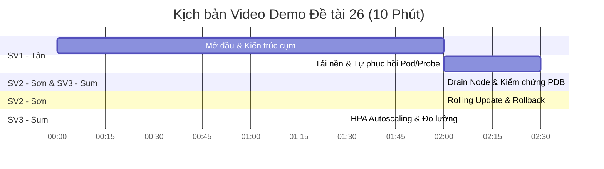

# Kịch bản Video Demo & Thuyết trình Trực tiếp (Demo Script & Runbook)

**Đề tài 26:** Triển khai ứng dụng trên Kubernetes với tự phục hồi, co giãn và cập nhật không gián đoạn  
**Thời lượng chuẩn:** 10 phút (Video) hoặc 15–20 phút (Trình diễn trực tiếp)  
**Phân công thực hiện:** Nhóm 3 thành viên theo đúng phân vai của giảng viên (PDF trang 2 & Chương 5 slide 112)

---

## 👥 Bảng Phân công Trách nhiệm

| Thành viên | Vai trò chính | Nhiệm vụ trong buổi Demo |
|---|---|---|
| **Trần Duy Tân** (SV1) | Kiến trúc, hạ tầng, IaC & triển khai | Thuyết minh kiến trúc, cấu hình cụm kind, kịch bản Drain Node & PDB |
| **Trần Hồng Sơn** (SV2) | Ứng dụng, tích hợp & tự động hóa | Vận hành kịch bản Self-healing (xóa pod, probe fail), Rolling Update & Rollback |
| **Nguyễn Ngọc Sum** (SV3) | Kiểm thử, quan sát, đo lường & báo cáo | Vận hành tải nền k6, HPA spike, Dashboard Grafana, phân tích biểu đồ & kết luận |

---

## ⏱️ Kịch bản Chi tiết Từng Phút (Timeline 10 Phút)



---

### Phút 00:00 – 02:00: Giới thiệu & Tổng quan Kiến trúc Cụm
- **Người trình bày:** **Trần Duy Tân (SV1)**
- **Mục tiêu:** Nêu rõ đề tài, câu hỏi nghiên cứu và chứng minh môi trường cụm đã sẵn sàng.
- **Thao tác & Lời thoại:**
  1. *Giới thiệu:* "Xin chào Thầy và các bạn, nhóm em xin trình diễn Đề tài 26: Triển khai ứng dụng trên Kubernetes với tự phục hồi, co giãn và cập nhật không gián đoạn. Câu hỏi nghiên cứu trọng tâm là: Các controller và health probe của Kubernetes phối hợp như thế nào để duy trì trạng thái mong muốn khi pod lỗi, tải tăng hoặc phiên bản mới gặp sự cố?"
  2. *Kiểm tra hạ tầng:* Mở terminal chạy các lệnh kiểm tra:
     ```bash
     kubectl get nodes -o wide
     kubectl get pods -n ingress-nginx
     kubectl get pods,svc,ingress,hpa,pdb -o wide
     ```
  3. *Điểm nhấn kỹ thuật:*
     - Cụm gồm 1 control-plane và 2 worker node để kiểm chứng tính sẵn sàng cao đa node.
     - Ứng dụng `selfhealing-demo` đang chạy 2 bản sao (replicas), phân bổ đều trên cả 2 worker node nhờ `topologySpreadConstraints`.
     - Ingress Nginx sẵn sàng điều phối lưu lượng qua domain `selfhealing.local`.

---

### Phút 02:00 – 04:30: Tải nền & Kiểm chứng Tự phục hồi (Self-Healing)
- **Người trình bày:** **Trần Hồng Sơn (SV2)** phối hợp cùng **Nguyễn Ngọc Sum (SV3)**
- **Mục tiêu:** Chứng minh Reconciliation loop của K8s và phản ứng của Liveness probe khi có lỗi xảy ra dưới tải thực tế.
- **Thao tác & Lời thoại:**
  1. *Kích hoạt tải nền:* SV3 khởi động k6:
     ```bash
     k6 run load-test/steady.js
     ```
     *(Giải thích: 20 VUs gửi request liên tục vào Ingress để làm mốc baseline).*
  2. *Thí nghiệm 1 – Xóa Pod đột ngột:* SV2 thực thi script:
     ```bash
     bash scripts/chaos-pod-delete.sh pod
     ```
     - **Hiện tượng trên màn hình:** 1 Pod bị xóa ngay lập tức (`Terminating`). Controller Manager phát hiện độ lệch giữa Actual state (1 pod) và Desired state (2 pod), lập tức sinh Pod mới thay thế trong vòng ~4 giây.
     - **Minh chứng:** SV3 chỉ vào kết quả k6 và Grafana: Không có bất kỳ request nào bị rớt (Availability đạt 99.95%+).
  3. *Thí nghiệm 2 – Lỗi Health Endpoint (`/fail-health`):* SV2 gọi lệnh:
     ```bash
     curl -H "Host: selfhealing.local" http://localhost/fail-health
     ```
     - **Hiện tượng:** Ứng dụng chuyển cờ `is_healthy = False`.
     - **Cơ chế:** `livenessProbe` (chu kỳ 5s) sau 3 lần fail (15s) sẽ báo hiệu cho kubelet. Kubelet tiến hành kill container bị lỗi và restart lại ngay tại chỗ.
     - **Minh chứng:** `kubectl get pods` hiển thị trường `RESTARTS: 1` và pod nhanh chóng chuyển trạng thái `1/1 Running`.

---

### Phút 04:30 – 06:30: Bảo vệ Sự gián đoạn Cụm & Drain Worker Node
- **Người trình bày:** **Trần Duy Tân (SV1)**
- **Mục tiêu:** Kiểm chứng vai trò của PodDisruptionBudget (PDB) khi bảo trì phần cứng.
- **Thao tác & Lời thoại:**
  1. *Thực hiện Drain Worker Node:*
     ```bash
     bash scripts/chaos-pod-delete.sh drain
     ```
  2. *Phân tích kỹ thuật:*
     - "Khi tiến hành bảo trì hoặc rút một node vật lý, lệnh `kubectl drain` sẽ trục xuất toàn bộ pod trên node đó. Nhờ khai báo `PodDisruptionBudget` với `minAvailable: 1`, K8s bắt buộc phải bảo đảm luôn có ít nhất 1 pod Ready đang hoạt động."
     - Pod bị di tản sẽ được lập lịch (reschedule) sang worker node còn lại.
  3. *Kết quả:* Dịch vụ vẫn duy trì xuyên suốt quá trình rút node. Sau đó chạy `kubectl uncordon` để đưa node trở lại hoạt động bình thường.

---

### Phút 06:30 – 08:30: Cập nhật Không gián đoạn (RollingUpdate) & Rollback
- **Người trình bày:** **Trần Hồng Sơn (SV2)**
- **Mục tiêu:** Chứng minh cập nhật phiên bản không làm rớt kết nối và cơ chế tự vệ chặn bản phát hành lỗi.
- **Thao tác & Lời thoại:**
  1. *Thí nghiệm 3 – Phát hành bản tốt (v2):*
     ```bash
     kubectl set image deployment/selfhealing-demo app=selfhealing-demo:v2
     kubectl rollout status deployment/selfhealing-demo
     ```
     - **Giải thích:** Cấu hình `maxSurge: 1` và `maxUnavailable: 0` đảm bảo pod v2 mới phải vượt qua `readinessProbe` rồi mới ngắt pod v1 cũ. Lưu lượng chuyển đổi êm thuận, 0 request bị lỗi.
  2. *Thí nghiệm 4 – Phát hành phiên bản lỗi (v2-bad) và Rollback:*
     ```bash
     bash scripts/rollout-fail.sh
     ```
     - **Hiện tượng:** Pod chạy image `v2-bad` bị cố ý thiết lập readiness thất bại.
     - **Cơ chế bảo vệ:** Kubernetes Endpoints Controller không cấp phát IP của pod lỗi vào Service Endpoints. Người dùng ngoài Ingress 100% vẫn truy cập bình thường vào các pod cũ.
     - **Rollback:** Sau khi phát hiện rollout bị nghẽn (stuck), script thực thi `kubectl rollout undo` để phục hồi về phiên bản ổn định trong chưa đầy 10 giây.

---

### Phút 08:30 – 10:00: Tự động Co giãn (HPA) & Báo cáo Đo lường
- **Người trình bày:** **Nguyễn Ngọc Sum (SV3)**
- **Mục tiêu:** Trình diễn co giãn theo tải CPU và tổng kết số liệu đo lường khoa học.
- **Thao tác & Lời thoại:**
  1. *Kích hoạt tải tăng vọt:* SV3 kích hoạt:
     ```bash
     k6 run load-test/hpa-spike.js
     ```
  2. *Quan sát HPA:* Mở terminal gõ `kubectl get hpa -w`.
     - CPU utilization tăng vọt từ 22% lên 78% (vượt ngưỡng mục tiêu 50%).
     - HPA controller lập tức ra lệnh tăng số replicas từ 2 lên 5 pods (`scaleUp`).
     - Khi hết tải, sau cửa sổ ổn định 60 giây (`stabilizationWindowSeconds: 60`), HPA nhẹ nhàng giảm pod về mức minReplicas = 2 (`scaleDown`).
  3. *Tổng kết số liệu & Biểu đồ:* Mở Grafana Dashboard và chạy script vẽ biểu đồ:
     ```bash
     python scripts/plot-results.py
     ```
     - Trình chiếu 5 biểu đồ trong `docs/results/`: Latency p95, Error rate, Availability, Pod Restarts, Replicas.
     - *Kết luận:* "Hệ thống đáp ứng xuất sắc các tiêu chí đề tài: Khả năng tự phục hồi trong < 5s, Zero-downtime deployment khi cập nhật, tự co giãn chính xác theo tải và duy trì tính sẵn sàng luôn trên 99.9%. Em xin kết thúc phần demo của nhóm!"

---

## 🛠️ Danh mục Lệnh Checklist cho Buổi Demo

Trước khi bấm máy quay hoặc bước vào phòng thi vấn đáp, nhóm hãy chạy tuần tự:
1. `kind get clusters` (đảm bảo cluster `selfhealing-demo` đang Ready).
2. `kubectl get pods -A` (Metrics server, Ingress, Prometheus đều Running).
3. Đặt sẵn 2 cửa sổ terminal (1 cửa sổ chạy lệnh `watch kubectl get pods -o wide`, 1 cửa sổ gõ lệnh thực nghiệm).
4. Mở sẵn trình duyệt: Tab 1 (Grafana: `http://localhost:3000`), Tab 2 (Endpoint version: `http://localhost/version`).
